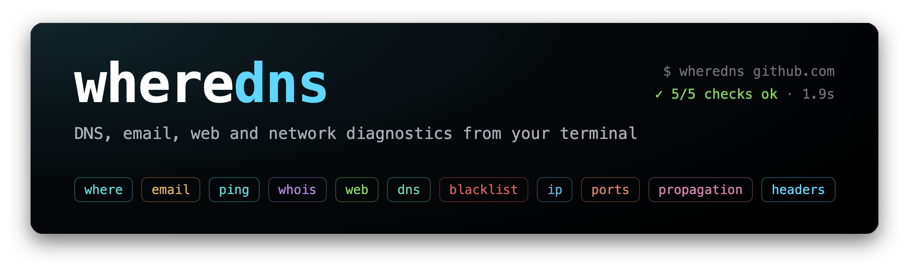
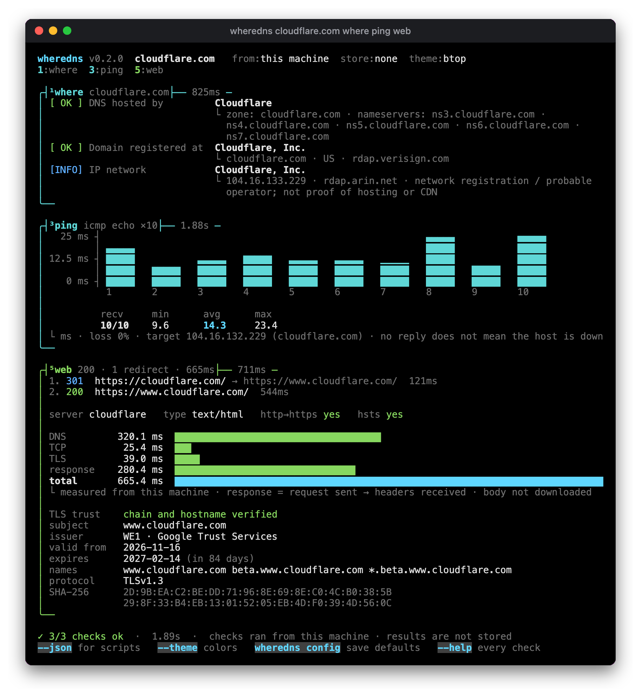
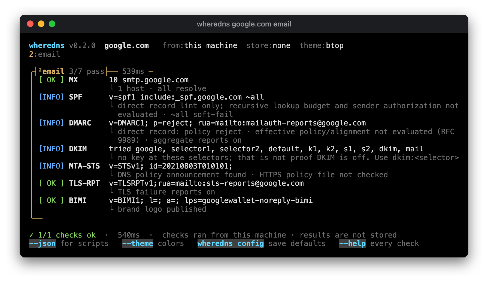
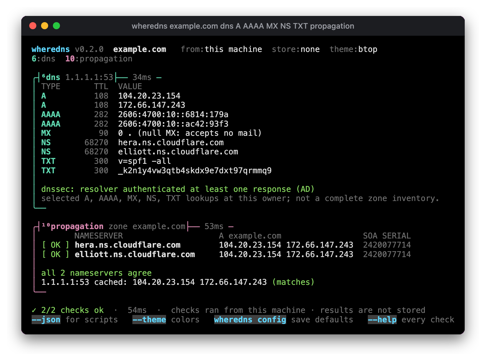
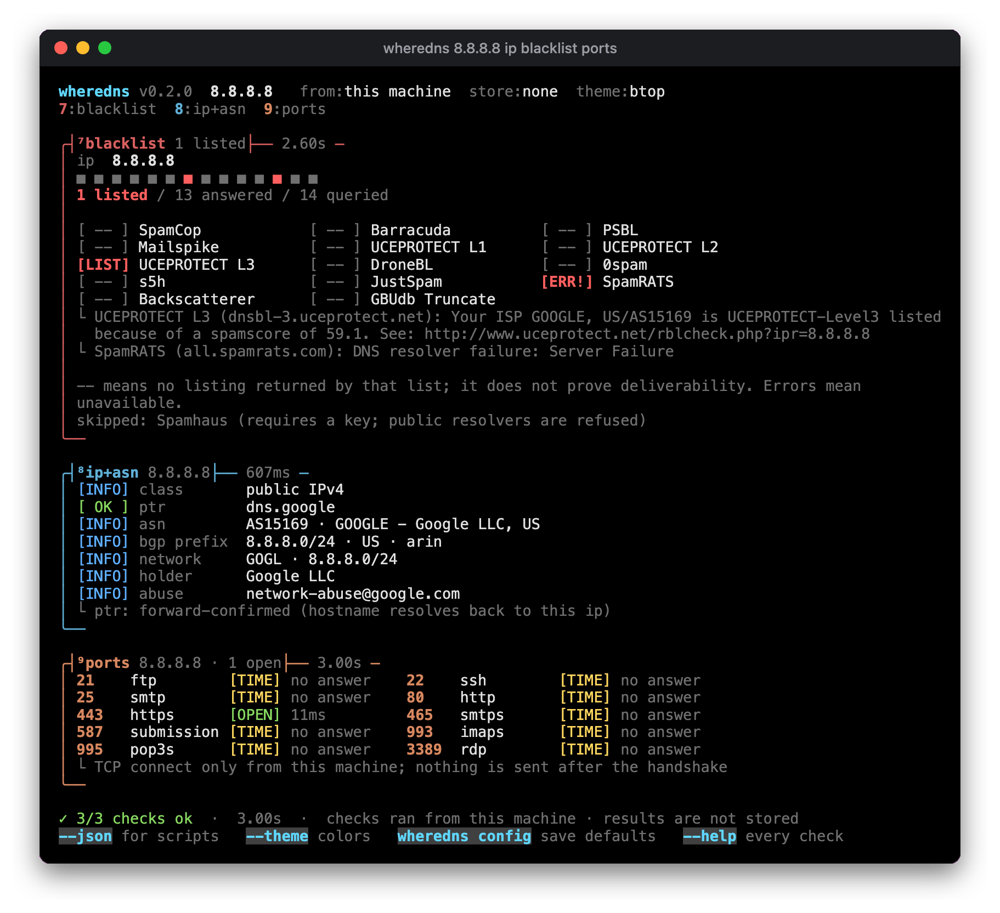
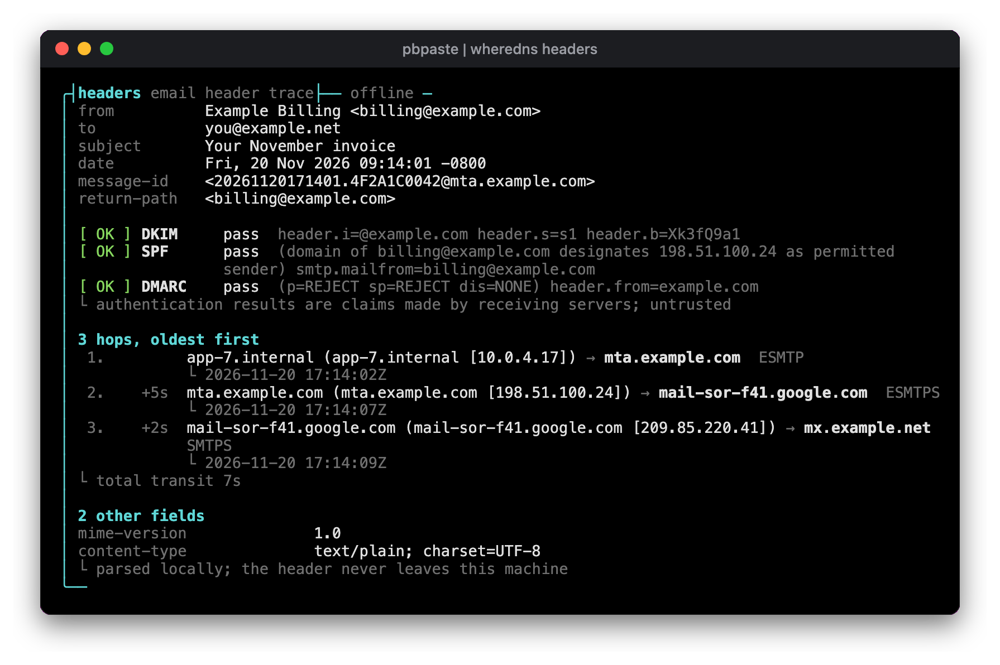
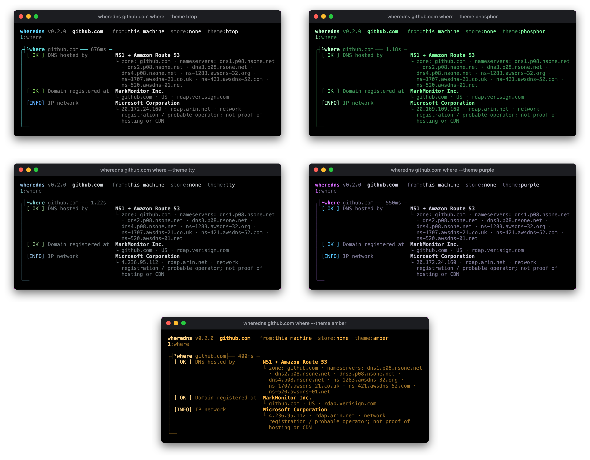

<p align="center">
  
</p>

<p align="center">
  <a href="https://github.com/Shroomate/wheredns-cli/actions/workflows/ci.yml"></a>
  <a href="https://github.com/Shroomate/wheredns-cli/releases/latest"></a>
  
  <a href="docs/TESTING.md"></a>
  <a href="LICENSE"></a>
</p>

<p align="center">
  Point it at a domain, IP address or URL to see who hosts the DNS, whether email
  is set up correctly, how the site responds and what the network looks like.
  Everything runs from your machine: no account, no API key, no telemetry.
</p>

## Install

**Homebrew** (macOS and Linux)

```sh
brew trust shroomate/tap
brew install shroomate/tap/wheredns
```

Homebrew 7 and later only load formulae from third-party taps after they are
trusted.

**Prebuilt binaries**: download, extract, and put `wheredns` on your `PATH`.

| Platform | Download |
|---|---|
| macOS, Apple silicon | [`aarch64-apple-darwin.tar.gz`](https://github.com/Shroomate/wheredns-cli/releases/latest) |
| macOS, Intel | [`x86_64-apple-darwin.tar.gz`](https://github.com/Shroomate/wheredns-cli/releases/latest) |
| Linux x86_64 | [`x86_64-unknown-linux-gnu.tar.gz`](https://github.com/Shroomate/wheredns-cli/releases/latest) |
| Windows x86_64 | [`x86_64-pc-windows-msvc.zip`](https://github.com/Shroomate/wheredns-cli/releases/latest) |

Each release includes `SHA256SUMS`.

**From source** (stable Rust)

```sh
cargo install --git https://github.com/Shroomate/wheredns-cli --locked
```

Cargo installs to `~/.cargo/bin`. Add it to `PATH` if `wheredns` is not found.

## Quick start

```sh
wheredns github.com
```

<p align="center">
  
</p>

With no checks, a domain runs `where email ping whois web` and an IP address
runs `ping whois web ip`. Checks run concurrently, and each panel shows up as
its results arrive.

## What it checks

| Check | Output |
|---|---|
| `where` | DNS hosting provider, registrar, IP network owner |
| `email` | MX, SPF, DMARC, DKIM, MTA-STS, TLS-RPT and BIMI, with lint notes |
| `ping` | 10 ICMP echoes: latency chart, loss, min/avg/max |
| `whois` | RDAP registration: registrar, dates, status, nameservers, DNSSEC |
| `web` | Status, redirects, DNS/TCP/TLS/response timing, certificate, HSTS, HTTP to HTTPS |
| `dns [TYPES]` | 14 record types plus SRV/TLSA presets, or the given types; DNSSEC AD flag |
| `blacklist` | The IP, or the domain's mail servers, on 14 DNS blocklists |
| `ip` | Reverse DNS with forward confirmation, ASN, BGP prefix, network owner |
| `ports [N ...]` | Common TCP ports, or up to 10 given ports |
| `propagation` | Each authoritative nameserver queried directly; answers and SOA serials compared |
| `subdomains` | 20 common names, with randomized wildcard controls |
| `dkim:SEL` | Email check using the given DKIM selector |
| `headers` | Email header read from stdin: hop trace, delays, authentication results |
| `all` | Every check except `headers` |

```sh
wheredns google.com email dkim:20230601
wheredns example.com dns A MX TXT propagation
wheredns 8.8.8.8 blacklist ip
wheredns cloudflare.com web ports 22 443 8443
wheredns example.com all
pbpaste | wheredns headers
```

## Screenshots

<table>
  <tr>
    <td width="50%" valign="top">
      <b>Email authentication</b><br>
      <sub><code>wheredns google.com email</code></sub><br><br>
      
    </td>
    <td width="50%" valign="top">
      <b>Records and propagation</b><br>
      <sub><code>wheredns example.com dns A AAAA MX NS TXT propagation</code></sub><br><br>
      
    </td>
  </tr>
  <tr>
    <td width="50%" valign="top">
      <b>IP reputation and reachability</b><br>
      <sub><code>wheredns 8.8.8.8 ip blacklist ports</code></sub><br><br>
      
    </td>
    <td width="50%" valign="top">
      <b>Email header trace (offline)</b><br>
      <sub><code>pbpaste | wheredns headers</code></sub><br><br>
      
    </td>
  </tr>
</table>

### Themes

Five color themes, plus `ansi` and `none`. Pick one with `--theme`, or save it with
`wheredns config set theme NAME`. `ansi` uses the terminal's own 16 colors, so
it follows a light or dark terminal theme; `none` turns colors off.

<p align="center">
  
</p>

## Options

| Option | Default | |
|---|---|---|
| `--json` | | JSON output (`schema_version` 2) |
| `--theme NAME` | `btop` | `btop`, `tty`, `purple`, `phosphor`, `amber`, `ansi`, `none` |
| `--animate MODE` | `full` | `full` (live panels), `minimal` (progress line), `off` |
| `--resolver IP:PORT` | `1.1.1.1:53` | Recursive resolver |
| `--timeout SECS` | 5 | Per-operation timeout |
| `--deadline SECS` | 60 | Whole-run deadline |
| `--allow-private` | off | Allow private, loopback and other non-public destinations and resolvers |

Run `wheredns --help` for the full list.

Output that is not a terminal is plain text with no escape sequences.
`NO_COLOR=1` disables colors.

### Settings

```sh
wheredns config                           # show settings and the file path
wheredns config set theme tty
wheredns config set checks where web dns  # default checks for a domain
wheredns config set animate off
wheredns config set background true       # paint the theme background
wheredns config unset theme
```

Settings are stored in `~/.config/wheredns/config` (or
`$XDG_CONFIG_HOME/wheredns/config`). Command-line flags override
`WHEREDNS_THEME` and `WHEREDNS_ANIMATE`, which override the file.

### Scripting

`--json` prints one versioned document per run, and the exit code tells you
what happened:

| Code | Meaning |
|---|---|
| 0 | All checks completed |
| 1 | A check failed |
| 2 | Invalid input |
| 130 | Cancelled, or the deadline was reached |

NXDOMAIN and NODATA are results, not failures. SERVFAIL, REFUSED, failed
subqueries and a nonzero `ping` exit fail the check.

```sh
wheredns example.com email --json | jq '.results[0].data.findings[] | {name, kind}'
```

## Network behavior

- DNS, HTTP, TLS and RDAP are implemented in Rust. ICMP uses the system `ping`
  (`ping6` for IPv6 on macOS).
- Requests go to the configured resolver, the target, the 14 blocklist zones
  and rdap.org (which redirects to the registry). There is no wheredns service,
  account or telemetry.
- HTTP requests are `HEAD` with the user agent
  `wheredns/VERSION (+https://github.com/Shroomate/wheredns-cli)`. Each redirect
  hop is resolved, checked against the destination policy and pinned. Proxies
  are not used.
- Private, loopback, link-local, shared, documentation and benchmark ranges are
  refused unless `--allow-private` is given.
- `headers` reads at most 64 KiB of UTF-8 from stdin and makes no network
  requests.

## Testing

84 test cases, all offline, run in CI on Linux, Windows and macOS (ARM64 and
Intel). DNS and HTTP behavior is tested against loopback fixtures, so results
never depend on live internet data. The full list is in
[docs/TESTING.md](docs/TESTING.md).

```sh
cargo test --locked
cargo build && python3 tests/loopback_regressions.py && python3 tests/dns_eligibility.py
```

## Development

```sh
cargo fmt --check
cargo clippy --locked --all-targets -- -D warnings
cargo test --locked
```

Screenshots are regenerated with `scripts/screenshots/generate.sh`. Release
steps are in [packaging/README.md](packaging/README.md). Report security issues
as described in [SECURITY.md](SECURITY.md).

## License

MIT
